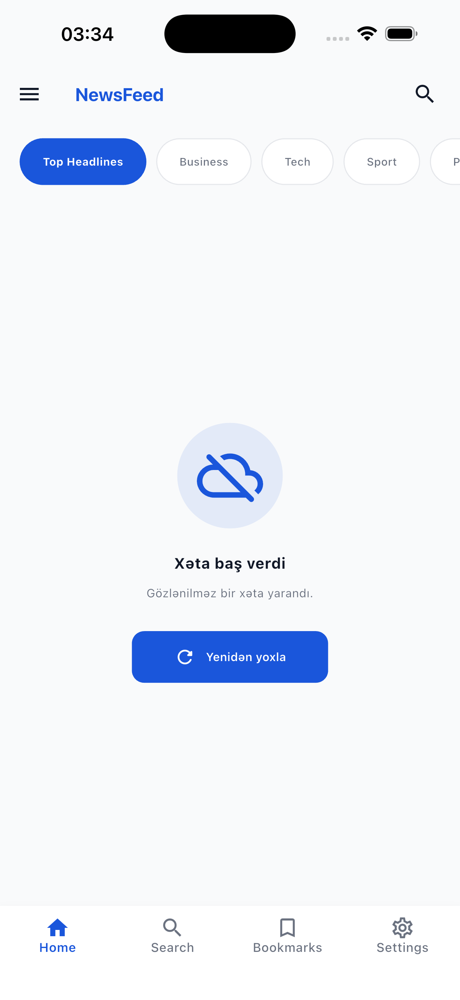

# NewsFeed 📰

A news reading app built with Flutter, based on Clean Architecture principles. It fetches news by category via [The Guardian API](https://open-platform.theguardian.com/), and supports search, bookmarks, read-article tracking, dark/light theme, and font size adjustment.

## ✨ Features

- **Home** — news feed by category, automatic loading of the next page as you scroll down (infinite scroll)
- **Search** — search news by keyword, recent searches
- **Article detail** — link to the original source via WebView, adjustable font size
- **Bookmarks** — save articles and view them offline
- **Read article tracking** — remembers which articles have been read
- **Onboarding** — category selection based on the user's interests
- **Settings** — dark/light theme, font size slider
- **Image caching** — optimized image loading with `cached_network_image`
- **Offline support** — appropriate warning when there is no internet connection

## 🏗️ Architecture

The project is organized layer by layer following **Clean Architecture** principles:

```
lib/
├── app/                  # App's root widget
├── core/                 # Shared helper layers
│   ├── constants/        # Colors, text styles, spacing, strings
│   ├── di/               # Dependency Injection (get_it)
│   ├── error/            # Failure / Exception classes
│   ├── network/          # API constants, secure storage
│   ├── router/           # go_router configuration
│   ├── theme/            # Theme management
│   └── widgets/          # Shared widgets
└── features/             # Each feature with its own layers
    ├── home/
    ├── search/
    ├── article_detail/
    ├── bookmarks/
    ├── settings/
    ├── onboarding/
    ├── webview/
    └── news/             # Domain + Data layers (repository, usecase, model, entity)
        ├── data/
        └── domain/
```

Each feature is split into `presentation` (UI + Cubit), `domain` (entities, usecases, repository interface), and `data` (models, datasources, repository impl) layers.

## 🛠️ Tech stack

| Category                   | Package                                    |
|-----------------------------|---------------------------------------------|
| State management            | `flutter_bloc` (Cubit)                     |
| Dependency Injection        | `get_it`                                   |
| Network                     | `dio`                                      |
| Routing                     | `go_router`                                |
| Local storage               | `get_storage`, `flutter_secure_storage`   |
| Image caching               | `cached_network_image`                    |
| Responsive UI               | `flutter_screenutil`                     |
| Functional error handling   | `dartz` (Either/Failure)                  |
| Connectivity                | `connectivity_plus`                      |

## 🚀 Getting started

### Requirements

- Flutter SDK (stable channel)
- Dart SDK
- A Guardian API key — get one for free [here](https://open-platform.theguardian.com/access/)

### Setup

```bash
git clone <repo-url>
cd news_feed
flutter pub get
```

### Set your API key

In `lib/core/network/api_constants.dart`, add your own API key:

```dart
class ApiConstants {
  static const String baseUrl = 'https://content.guardianapis.com';
  static const String apiKey = 'YOUR_API_KEY_HERE';
  static const int pageSize = 20;
}
```

### Run

```bash
flutter run
```

## 📄 API

The app uses [The Guardian Content API](https://open-platform.theguardian.com/documentation/):

- `GET /search` — fetch news by category (via the `section` parameter)
- `GET /search?q=` — search by keyword
- Pagination is handled via the `page` and `page-size` parameters

## 📱 Screens

- Onboarding → interest selection
- Home → category tabs + news feed (infinite scroll)
- Search → search input + results / recent searches
- Article detail → full content + WebView link
- Bookmarks → saved articles
- Settings → theme and font size adjustments

## 📸 Screenshots

<table>
<tr>
<td align="center"><b>Onboarding</b><br/></td>
<td align="center"><b>Home</b><br/></td>
<td align="center"><b>Search</b><br/></td>
</tr>
<tr>
<td align="center"><b>Bookmarks</b><br/></td>
<td align="center"><b>Settings</b><br/></td>
<td align="center"><b>Edit interests</b><br/></td>
</tr>
<tr>
<td align="center"><b>Article detail</b><br/></td>
<td align="center"><b>No internet</b><br/></td>
<td></td>
</tr>
</table>

## 📝 License

This project was built for educational/demo purposes.
